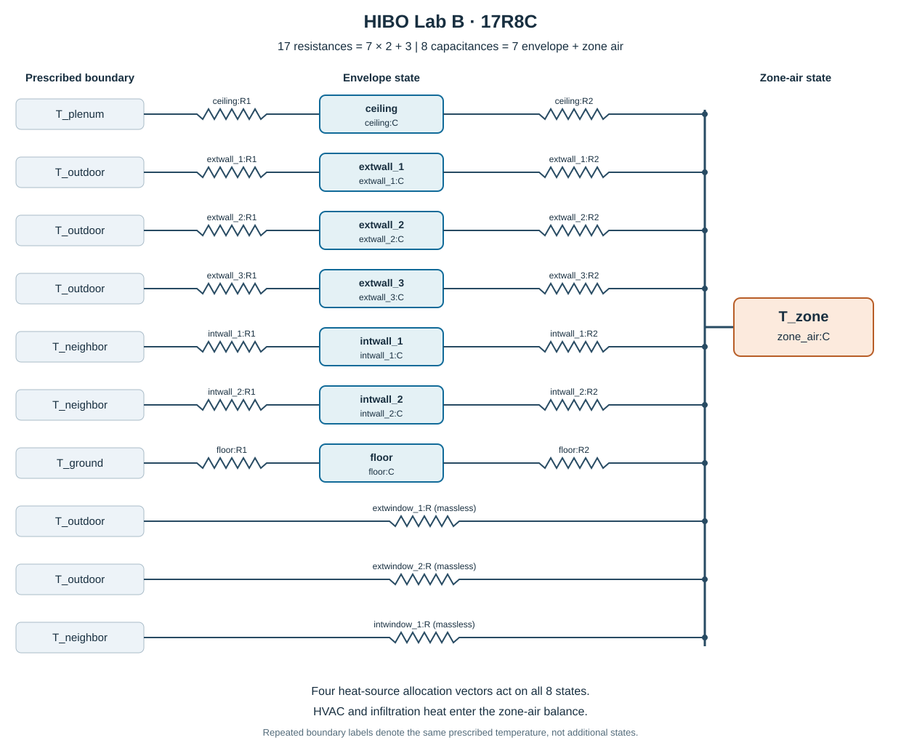
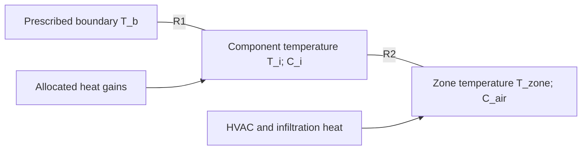

# Initial 17R8C model and prior construction

The Lab B model has **17 thermal resistances and 8 temperature states**: seven capacitive envelope components, three massless window paths, and the zone-air state. Its topology and prior centers are fixed before MCMC. The sampler subsequently estimates all 17 R and all 8 C independently, together with heat-gain allocation and noise parameters.



## Files

| File | Content |
|---|---|
| `derive_reference.py` | Rebuilds the calibration reference from IDF surfaces, layers, and declared lumping conventions |
| `reference.json` | Reconstructed reference; byte-identical to the reference used by the completed run |
| `network.json` | Full state, boundary, component, resistance, and capacitance definition |
| `components.csv` | All ten envelope components, their IDF objects, areas, and reference values |
| `resistances.csv` / `capacitances.csv` | Every network edge and state, with units and reference values |
| `idf_patches.csv` | 31 construction patches before aggregation into the ten components |
| `idf_layers.csv` | 70 material-layer records supporting the patch calculations |
| `prior_parameters.csv` | Physical mean/SD and log-space parameters for all 25 R/C priors |
| `priors.json` | Thermal, allocation, and noise prior definitions; 55 independent parameters |
| `derivation_validation.json` | Hash and exact-reference reproduction check |
| `build_network_metadata.py` | Rebuilds the network tables, prior tables, and SVG from `reference.json` |

From the repository root:

```bash
python 02_thermal_model/derive_reference.py --check
```

To regenerate the documented reference and tables:

```bash
python 02_thermal_model/derive_reference.py
python 02_thermal_model/build_network_metadata.py
```

These commands do not modify the calibrated values or MCMC results. The derivation stops if the reconstructed reference differs from the archived calibration reference.

## Network definition

| Component | IDF surfaces or windows | Prescribed boundary | R | C |
|---|---|---|---:|---:|
| ceiling | Surface 8; Surface 71 | Plenum | 2 | 1 |
| extwall_1 | Surface 69 Ext; Surface 69 Low CMU | Outdoor | 2 | 1 |
| extwall_2 | Surface 70 Ext | Outdoor | 2 | 1 |
| extwall_3 | Surface 3 Ext | Outdoor | 2 | 1 |
| intwall_1 | Surface 5; Surface 6 | Space 102 - Plus | 2 | 1 |
| intwall_2 | Surface 4 | Space 102 - Plus | 2 | 1 |
| floor | Surface 1 | Ground | 2 | 1 |
| extwindow_1 | HIBO CWC LabB Vision | Outdoor | 1 | 0 |
| extwindow_2 | HIBO CWA LabB West Lower CTIG; HIBO CWA LabB West Upper CTIG | Outdoor | 1 | 0 |
| intwindow_1 | HIBO Type A LabB-Control CTG A; HIBO Door 103 CTG Lite A | Space 102 - Plus | 1 | 0 |
| zone_air | Lab B air volume | Calculated state | 0 | 1 |
| **Total** | | | **17** | **8** |

The `ceiling` component includes the short partition area (Surface 71) adjoining the plenum. Plenum temperature is a prescribed input, not a ninth state. Roof surfaces have no independent branch in this room-level network. Door leaves and opaque frame strips are included in their host opaque component's reference calculation; no independent door state is introduced. Window host indices record geometry only and do not restrict the later all-pairs reduction.

Each opaque component is connected as:



A massless window has a single resistance directly between its prescribed boundary and `T_zone`. HVAC and infiltration conductances are time-dependent known inputs; they are not counted among the 17 estimated envelope resistances.

For massive component *i*:

\[
C_i\dot T_i=(T_{b_i}-T_i)/R_{1,i}+(T_z-T_i)/R_{2,i}
  +\sum_s\alpha_{s,i}Q_s.
\]

For zone air:

\[
C_z\dot T_z=\sum_i(T_i-T_z)/R_{2,i}
 +\sum_w(T_{b_w}-T_z)/R_w
 +\sum_s\alpha_{s,z}Q_s
 +g_{HVAC}(T_{supply}-T_z)+g_{inf}(T_{outdoor}-T_z).
\]

The four prescribed boundary series are plenum, outdoor, Space 102 - Plus, and ground temperature, in that order. The four gain series are transmitted solar, lighting, occupant sensible, and equipment sensible heat. Each gain is allocated over the seven massive states plus zone air.

## From IDF layers and geometry to reference R and C

The derivation reproduces the construction conventions in the archived `prepare_reference.py`. It is a lumped prior-reference calculation; it is not a claim that the RC parameters equal independently measured physical truth.

For material layer *l*, thickness *d*, conductivity *k*, density *rho*, and specific heat *c_p* give:

\[
r_l=d_l/k_l,\qquad c_l=d_l\rho_lc_{p,l}.
\]

Here *r* has units m² K/W and *c* has units J/(m² K). `Material:NoMass` and `Material:AirGap` contribute their IDF resistance but zero capacity. Simple glazing uses its IDF U-factor, which already includes surface films. The interior glass uses thickness/conductivity plus the declared films and has no estimated capacity.

Areas are computed from the IDF 3D polygon vertices. Glazing, opaque opening patches, and the CWC external frame area are subtracted from host wall area. Each opaque door leaf or frame-strip patch is then included using its own construction, in the same host component.

### R1 and R2 are reference assumptions, not two independent IDF measurements

For patch *p* of net area *A_p*, let *r_mat* be the sum of material-layer areal resistances. The material resistance is split equally around the lumped state:

\[
R_{1,p}=(r_{mat}/2+r_{b,film})/A_p,\qquad
R_{2,p}=(r_{mat}/2+r_{z,film})/A_p.
\]

| Film convention | Areal resistance (m² K/W) |
|---|---:|
| Zone-air side | 0.13 |
| Outdoor boundary side | 0.04 |
| Plenum or neighboring-zone side | 0.13 |
| Ground boundary side | 0.00 |

The ground-temperature input is treated as the prescribed outside-face boundary, with no additional soil resistance or exterior film. These film values and the half-material split are declared modeling conventions. IDF construction data determine layer properties and total material resistance; they do not uniquely determine the lumped state's R1/R2 partition.

Patch capacity is:

\[
C_p=A_p\sum_l d_l\rho_lc_{p,l}.
\]

For patches aggregated into one component, define \(G_p=1/(R_{1,p}+R_{2,p})\). The reference construction preserves total steady conductance and summed capacity, and averages the R1 fraction with conductance weights:

\[
R=\left(\sum_pG_p\right)^{-1},\quad
f=\frac{\sum_pG_p R_{1,p}/(R_{1,p}+R_{2,p})}{\sum_pG_p},
\quad R_1=fR,\quad R_2=(1-f)R,\quad C=\sum_pC_p.
\]

This approximation provides an initial lumped reference. During MCMC, **R1, R2, and C remain separate free parameters**. Neither the reference split nor `R1 + R2` is held fixed.

### Window frame and divider correction

For the CWC window, the archived calculation includes an approximate conductance correction from its `WindowProperty:FrameAndDivider` object. Frame area lies outside the glazing rectangle:

\[
A_f=(W+2w_f)(H+2w_f)-WH,
\quad A_d=w_d(n_hW+n_vH)-n_hn_vw_d^2.
\]

The film-adjusted frame/divider U-factors are \(U_f=(1/K_f+0.17)^{-1}\) and \(U_d=(1/K_d+0.17)^{-1}\). The correction is

\[
\Delta G=A_fU_f+A_d(U_d-U_{glass}),\qquad U_{glass}=1.36\;\mathrm{W/(m^2 K)}.
\]

This yields `frame_area = 0.62967616 m²` and `frame_G_correction = 2.68589663 W/K`. It is an approximate prior correction rather than a full reproduction of EnergyPlus frame heat-transfer calculations. Parallel glazing conductances and this correction determine the one massless window resistance.

### Zone-air reference capacity

The air capacity uses the modeled Lab B floor area, 18.413809881984 m², a 3.048 m height, and fixed air-property reference values:

\[
C_{air,ref}=\rho_{air}c_{p,air}V
=1.2\times1005\times18.413809881984\times3.048
=67687.10277946641\;\mathrm{J/K}.
\]

This capacity is estimated in the initial MCMC. It is not held at the IDF-derived reference value.

## Prior mean and SD

For each of the 25 thermal parameters *x* (17 R and 8 C):

\[
x\sim\operatorname{LogNormal}(\mu_{\log},s_{\log}^2),
\quad E[x]=x_{ref},\quad SD[x]=2x_{ref},
\]

\[
s_{\log}=\sqrt{\log5},\qquad
\mu_{\log}=\log x_{ref}-\tfrac12\log5.
\]

The **reference mean** comes from the IDF calculation and the conventions above. The **coefficient of variation of 2** is the chosen broad-prior setting; it is not an uncertainty field supplied by the IDF. The physical mean is not the lognormal median. Every thermal prior is independent in the physical parameterization, despite transformed coordinates used internally by the sampler.

For each of four heat sources, the eight allocation fractions follow `Dirichlet(1, ..., 1)`. Their sum is one, giving seven independent allocation parameters per source: 28 independent and 32 reported fractions. Allocation and noise priors are not derived from the IDF.

The hour-reference AR(1) noise priors are:

- `log(sigma_hour) ~ Normal(log(0.3), 1²)`, truncated to `[-5, 2]`.
- `eta ~ Normal(1.5, 1.5²)`, truncated to `[-5, 6]`.
- `rho_hour = 0.98 * sigmoid(eta)`.

The likelihood uses the corresponding five-minute parameters as documented in `priors.json` and implemented in `03_workflow/initial/src/model.py`.

The complete independent parameter count is `17 R + 8 C + 28 alpha + 2 noise = 55`; the output count is `17 + 8 + 32 + 2 = 59`.
