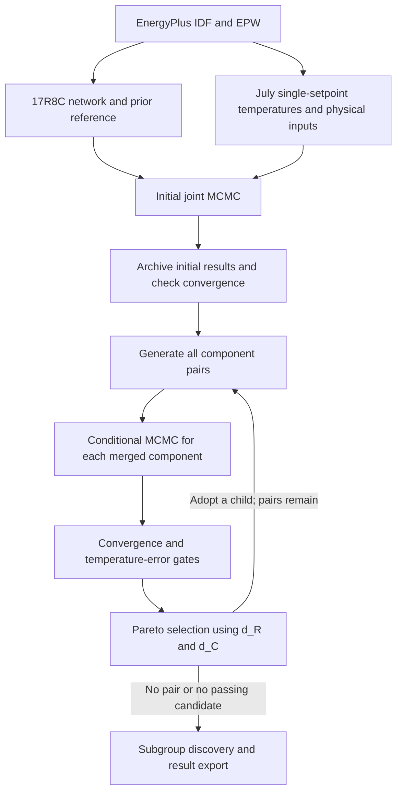

# HIBO Lab B thermal-model calibration and reduction

This repository contains the EnergyPlus model and weather, the IDF-derived 17R8C reference network, the single-setpoint calibration pipeline, and the completed October 24–25, 2026 calculation. The study varies the Lab B thermostat across 20, 22, 24, 26 and 28°C during July. The other zones retain their operating schedules.

The initial Bayesian calibration estimates 55 independent parameters. The reduction loop evaluates every unordered envelope-component pair at each adopted model, calibrates each merged component, selects a passing candidate using two Pareto objectives, and repeats. Binary and numeric subgroup discovery use the accumulated candidate records.

## Study sequence



## Repository contents

| Directory | Contents |
| --- | --- |
| [`01_energyplus`](01_energyplus/README.md) | Single-setpoint IDF, Omaha TMY3 EPW, simulation command and input provenance |
| [`02_thermal_model`](02_thermal_model/README.md) | 17R8C topology, component mapping and reproducible IDF-to-prior derivation |
| [`03_workflow`](03_workflow/README_KO.md) | Initial sampler, reduction loop, subgroup analysis, fixed settings, raw E+ CSV and processed inputs |
| [`04_results`](04_results/README.md) | Curated parameter tables, selected-path diagnostics, final model and subgroup rules |
| [`05_analysis`](05_analysis) | Completed-results review |
| [`docs`](docs) | Reproduction and publication checks |
| `runs/` | New working calculations; created locally and excluded from Git |

The supplied result summaries describe the archived calculation. Starting a new run does not import its posterior draws or overwrite `04_results/`.

## Environment

The recorded run used **64-bit Python 3.12.10** and **EnergyPlus 22.2.0**. Python dependencies are pinned in [`requirements.txt`](requirements.txt) to the recorded versions. EnergyPlus is needed to generate new simulation data; the original full July CSV and processed inputs are already included for calibration.

Windows PowerShell, from the extracted repository directory:

```powershell
py -3.12 -m venv .venv
.\.venv\Scripts\python.exe -m pip install -r requirements.txt
.\.venv\Scripts\python.exe verify_repository.py
.\.venv\Scripts\python.exe run.py verify
.\.venv\Scripts\python.exe run.py start
```

Linux/macOS environment setup:

```bash
python3.12 -m venv .venv
.venv/bin/python -m pip install -r requirements.txt
.venv/bin/python verify_repository.py
.venv/bin/python run.py verify
.venv/bin/python run.py start
```

The published run was performed on Windows. The launcher resolves paths on Windows and POSIX systems; a full production rerun on other platforms has not been performed for this release. Floating-point libraries and random-number execution can affect exact numerical reproducibility.

`run.py start` creates a new directory under `runs/`. An external empty location can be specified with `--workdir`. A dry run prints the command without launching MCMC:

```bash
python run.py start --dry-run
python run.py start --workdir runs/july_reproduction
python run.py status
python run.py stop
python run.py resume
python run.py export
```

Use one saved pipeline run per checkout. `resume` continues that run; `start` refuses to overwrite it. Use a fresh extracted copy or checkout for another independent run. The controller exports archives under `03_workflow/exports/` and verifies the initial archive before any reduction begins.

## Data and statistical specification

| Item | Specification |
| --- | --- |
| Target | `THERMAL ZONE: SPACE 103 LAB B` |
| Conditioning | July 1; excluded from likelihood and reported temperature scores |
| Training | July 2–22 |
| Validation / model selection | July 23–31 |
| Physical inputs | 1-minute observations, 44,640 records |
| Thermal integration | Two 30-second backward-Euler steps per minute |
| Likelihood | 5-minute endpoint temperatures, time-scaled AR(1) residual model |
| Initial dimensions | 17 R + 8 C + 28 independent allocation coordinates + 2 noise parameters = 55 |
| Reported quantities | 17 R + 8 C + 32 allocation fractions + 2 noise parameters = 59 |
| R/C priors | Independent lognormal; physical mean = IDF-derived reference, physical SD = twice that reference |
| Allocation priors | One Dirichlet(1,…,1) over the eight thermal states for each of four heat sources |
| Convergence | Rank-normalized split/folded R-hat < 1.10; bulk ESS and 5%/95% tail ESS ≥ 400 |
| Reduction accuracy gate | Validation temperature RMSE ≤ 1°C |

The R/C prior means use geometry, construction properties and the documented lumping/film/frame assumptions. **SD = 2 × mean is a prior choice**, not uncertainty measured or reported by the IDF. The model keeps plenum, outdoor, adjacent-zone and ground temperatures as separate inputs.

The observed terminal discharge temperature already includes reheat. HVAC exchange is `m_dot * cp * (T_terminal - T_zone_model)`; reheat is not added a second time. This calculation calibrates the thermal model using observed supply conditions. It does not calibrate an autonomous SAT/ZAT controller.

## Completed experiment

The single-setpoint experiment used July 1 for conditioning, July 2–22 for calibration, and July 23–31 for validation and reduction selection. Physical inputs remained at one-minute resolution; the likelihood used five-minute endpoints. Temperature RMSE below uses every one-minute prediction outside conditioning.

### Initial 17R8C convergence

The 55 independent parameters produced 59 reported physical quantities. Four chains each retained 5,000 production draws after 12,000 adaptive warmup and 12,000 discarded fixed-kernel settling iterations.

| Coordinates | Maximum R-hat | Minimum bulk ESS | Minimum tail ESS |
|---|---:|---:|---:|
| Physical reported values | 1.003822 | 1501.764 | 1208.038 |
| Independent ordered coordinates | 1.006410 | 1043.847 | 436.536 |
| Required criterion | < 1.10 | ≥ 400 | ≥ 400 |

### Every accepted merge

Each row names both blocks merged at that step. A block can contain several original components. All selected candidates had Pareto rank 1.

| Step | Model | Left block | Right block | d_R | d_C |
|---:|---|---|---|---:|---:|
| 1 | M1: 16R8C | IntWall 1 | IntWindow 1 | 0.793191 | 0.062630 |
| 2 | M2: 15R8C | ExtWindow 1 | ExtWindow 2 | 0.965159 | 0.000000 |
| 3 | M3: 14R7C | Ceiling | ExtWall 2 | 0.594709 | 1.109954 |
| 4 | M4: 13R7C | ExtWindow 1 + ExtWindow 2 | Ceiling + ExtWall 2 | 1.029173 | 0.274577 |
| 5 | M5: 12R6C | Floor | Ceiling + ExtWall 2 + ExtWindow 1 + ExtWindow 2 | 0.742115 | 0.674921 |
| 6 | M6: 11R5C | ExtWall 3 | IntWall 1 + IntWindow 1 | 0.998291 | 0.663359 |
| 7 | M7: 9R4C | IntWall 2 | ExtWall 3 + IntWall 1 + IntWindow 1 | 1.563225 | 0.907479 |
| 8 | M8: 7R3C | Ceiling + ExtWall 2 + ExtWindow 1 + ExtWindow 2 + Floor | ExtWall 3 + IntWall 1 + IntWall 2 + IntWindow 1 | 1.781662 | 1.023193 |
| 9 | M9: 5R2C | ExtWall 1 | Ceiling + ExtWall 2 + ExtWall 3 + ExtWindow 1 + ExtWindow 2 + Floor + IntWall 1 + IntWall 2 + IntWindow 1 | 4.150205 | 2.433599 |

### Accuracy and convergence along the adopted path

Initial-model diagnostics below take the worst value across physical and ordered coordinates. Reduced-model diagnostics cover the locally re-estimated parameters conditional on the fixed parent values.

| Model | Topology | Train RMSE (°C) | Validation RMSE (°C) | Max R-hat | Min bulk ESS | Min tail ESS | PASS / candidates |
|---|---|---:|---:|---:|---:|---:|---:|
| M0 | 17R8C | 0.399558 | 0.410836 | 1.006410 | 1043.847 | 436.536 | — |
| M1 | 16R8C | 0.394393 | 0.405180 | 1.009022 | 676.229 | 414.298 | 43 / 45 |
| M2 | 15R8C | 0.393843 | 0.404872 | 1.001141 | 4360.177 | 4389.489 | 34 / 36 |
| M3 | 14R7C | 0.389361 | 0.354658 | 1.010005 | 477.062 | 404.904 | 28 / 28 |
| M4 | 13R7C | 0.392179 | 0.358967 | 1.009673 | 492.840 | 453.392 | 20 / 21 |
| M5 | 12R6C | 0.414757 | 0.377724 | 1.010718 | 419.250 | 483.487 | 15 / 15 |
| M6 | 11R5C | 0.458253 | 0.417950 | 1.014187 | 484.165 | 404.197 | 10 / 10 |
| M7 | 9R4C | 0.423328 | 0.391546 | 1.011976 | 476.002 | 523.254 | 6 / 6 |
| M8 | 7R3C | 0.524222 | 0.493629 | 1.011639 | 415.178 | 613.936 | 3 / 3 |
| M9 | 5R2C | 0.610500 | 0.585278 | 1.022369 | 408.334 | 708.753 | 1 / 1 |

There were 165 distinct candidate pairs and 166 attempts: 160 final PASS outcomes, no resolved FAIL outcomes, and five UNRESOLVED alternatives. The final candidate required a fresh rescue attempt and passed with 15,000 retained draws per chain. Its primary attempt had minimum bulk ESS 288.008 and was not accepted. The loop stopped after nine merges because no envelope pair remained.

For each candidate, only the newly merged R/C and allocation fractions were re-estimated. Other blocks, zone-air capacitance, and noise parameters stayed fixed. PASS required local convergence and validation RMSE ≤ 1°C. Candidates on the first Pareto front were ranked by validation RMSE, model size and trial identifier when a tie-break was needed. One PASS was sufficient.

The final 5R2C is the smallest topology allowed by this model family. M3 (14R7C) had the lowest validation RMSE on the adopted path. Validation was reused for acceptance and selection; these values are not untouched final-test scores. The five unresolved alternatives could have changed the greedy path had their posteriors been adequately sampled.

### Subgroup findings

Binary subgroup discovery had no PASS/FAIL contrast: all 160 resolved candidates passed. Numeric discovery used 112 massive–massive PASS trials representing 47 member-set pairs across nine stages. It searched for jointly lower within-stage ranks of postfit d_R and d_C, with support ≥ 10, at least three stages, coverage ≤ 85%, and at most two conditions.

| Rule | Readable condition | Trials / unique pairs / stages | Mean d_R: subgroup / reference | Mean d_C: subgroup / reference | Relative reduction R / C |
|---|---|---|---:|---:|---:|
| N01 | R_eff ratio ≤ 5 and C ratio ≤ 4.183971 | 23 / 9 / 6 | 1.142005 / 1.861545 | 0.680632 / 1.132130 | 38.65% / 39.88% |
| E02 | R_eff ratio ≤ 4 and C ratio ≤ 4 | 16 / 6 / 6 | 0.981903 / 1.850792 | 0.634276 / 1.121173 | 46.95% / 43.43% |
| N04 | C ratio ≤ 3.831351 and max R_eff ≤ 1.018915 K/W | 24 / 10 / 7 | 1.196559 / 1.912563 | 0.724756 / 1.148331 | 37.44% / 36.89% |
| E01 | R_eff ratio ≤ 3; not jointly eligible | 14 / 6 / 6 | 1.123115 / 1.864770 | 1.140624 / 1.130052 | 39.77% / -0.94% |

A ratio is the larger parent value divided by the smaller. References are stage averages weighted to match each subgroup’s stage composition and include subgroup members. E02 had 13 of 16 trials below both stage medians; three were exceptions, and only three were first-front candidates. E01 did not improve both targets.

The rules are exploratory, not guarantees of PASS or selection. Parent similarity contributes algebraically to the distance targets. Removing that contribution in a sensitivity analysis retained a favorable E02 association, but no independent rule-validation experiment, p-value, permutation test or multiple-testing adjustment was performed. The 30 reported rules overlap, and candidate records share inputs and adopted parents.

Curated parameter tables, all 30 numeric rules, the selected path and the final model are in [`04_results/`](04_results/). Raw chains, checkpoints, full candidate records and logs are excluded from this repository. Convergence does not establish unique identification of all individual physical parameters, and the thermal replay uses known EnergyPlus supply conditions rather than a closed-loop RL controller.

## Git and large files

Install [Git LFS](https://git-lfs.com/) before the first `git add`. The included `.gitattributes` tracks NumPy archives and the full E+ CSV with LFS. Text and data bytes are preserved without automatic newline conversion so recorded checksums remain valid.

```bash
git init
git lfs install
git add .
git lfs ls-files
git status
git commit -m "Add Lab B calibration, reduction, inputs and completed results"
```

After creating a remote repository, add its URL and push:

```bash
git branch -M main
git remote add origin <repository-url>
git push -u origin main
```

The full CSV exceeds GitHub's ordinary 100 MiB per-file limit. LFS is therefore required for this complete layout; a browser file upload does not replace the commands above. See [GitHub file limits](https://docs.github.com/en/repositories/working-with-files/managing-large-files/about-large-files-on-github) and [Git LFS configuration](https://docs.github.com/en/repositories/working-with-files/managing-large-files/configuring-git-large-file-storage).

## Verification and provenance

`python verify_repository.py` checks every released file against `RELEASE_MANIFEST_SHA256.json`. `docs/release_validation.json` records source equivalence, IDF/prior reconstruction, input-array reconstruction and launcher checks. Publication edits change comments, documentation and local-path metadata; the mathematical sampler and reduction statements remain unchanged. Source result-archive hashes are recorded with the curated results.

Raw chains, checkpoints and full trial records are excluded. The curated provenance identifies the archived run and source result archives. Completed-run summaries are not resume inputs for this edited source package. The archived v2-only `reprocess` command also enforces historical byte hashes and is not the reproduction entry point for this release. Use the root launcher for a fresh calculation.
